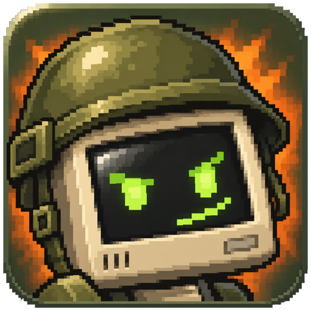
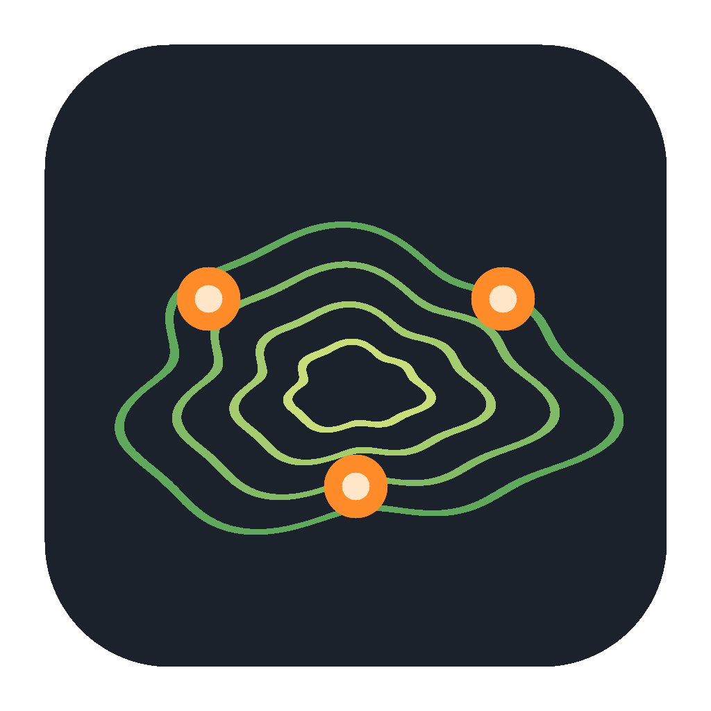

<p align="center"></p>

<p align="center"><a href="https://decombat.com">decombat.com</a></p>

DeCombat lets you play the 2009 Combat Arms EU build again, the way a console emulator plays a cartridge. You bring your own
2009 client folder (the "ROM"), and nothing of Nexon's ships here. DeCombat reads your folder read-only and never runs its
programs. The client, the servers and the bots are new code, written in Rust.

*Unofficial community project, not affiliated with or endorsed by Nexon or any other owner of the game. "Combat Arms" belongs
to its owner. See [NOTICE.md](NOTICE.md).*

You can play Team Deathmatch, One Man Army, Elimination, Search and Destroy, Capture the Flag, Spy Hunt, Quarantine and
Fireteam, with the lobby, shop, clans and inbox. Servers come in three kinds:

- **Vanilla:** the 2009 game with no mods.
- **Vanilla++:** adds Gun Game, Hardcore and Possession rooms and community maps, with every pack reviewed. It shares your
  progress with vanilla.
- **Modded:** whatever the operator runs, such as the [Hacking Mod](examples/mods/hacking_mod/README.md).

Expect rough edges.

## Install and play

You need your own 2009 Combat Arms EU client folder, the one with `Engine.exe` and a `Game` folder (about 3.2 GB). It stays
unchanged.

**Windows** (64-bit, Windows 10 or later)
1. Download the Windows zip from the [latest release](https://github.com/argallo/DeCombat/releases/latest) and unzip it.
2. Put your client folder inside the unzipped folder, next to `DeCombat.exe`.
3. Double-click `DeCombat.exe`. If SmartScreen objects, choose "More info", then "Run anyway". If Windows Defender flags
   it, that is a known false positive for new unsigned programs: you can report the file to Microsoft at
   https://www.microsoft.com/en-us/wdsi/filesubmission, and the release's `SHA256SUMS` tells you whether the zip is ours.

**macOS** (12 or later)
1. Download the macOS zip from the [latest release](https://github.com/argallo/DeCombat/releases/latest) and unzip it.
2. Put your client folder next to `DeCombat.app`.
3. Double-click the app. The first time, go to System Settings > Privacy & Security and click "Open Anyway". If it can't see
   the folder, it asks you to pick it once.

**iPad** (Bluetooth keyboard and mouse required)

There's no download yet: you build the app on a Mac with Xcode and copy your client folder across. A free Apple ID's install
expires after 7 days. Some input details are still unverified on hardware. See [docs/IPAD.md](docs/IPAD.md).

On first start, enter your account name, then your password on the login screen. Register with the login screen's register
button; some servers ask for an invite code. Pick a server and channel, then create or join a room.

## Write a mod

A mod is a folder of Lua and data files that runs in a sandbox and can only do what its manifest declares.

```sh
dc-modkit scaffold my_mod --profile content
dc-modkit validate my_mod && dc-modkit lint my_mod && dc-modkit pack my_mod -o my_mod.zip
```

Start with the [modding guide](docs/MODDING_GUIDE.md). Anyone can run any mod on their own modded server. Packs for Vanilla++
are reviewed: a new gun has to be balanced against the original guns, not beat them, and NX is earned in play, never bought
([section 12](docs/MODDING_GUIDE.md#12-making-content-for-vanilla)).

Working with an AI tool? [AGENTS.md](AGENTS.md) and the [modding skill](.claude/skills/modding/SKILL.md) give it these rules.

## Build a map



MapKit builds new maps with no game files in the project, using a command line and an editor (`dc-mapkit-gui`). The MapKit
zips are on the [latest release](https://github.com/argallo/DeCombat/releases/latest).

1. **Project:** `dc-mapkit new my_map --template arena` makes a text project: `map.json`, a heightmap and your own textures.
2. **Build:** shape it with JSON ops or Lua generators, then run `dc-mapkit validate` and `dc-mapkit build`.
3. **Look:** `dc-mapkit render my_map --view top --labels`.
4. **Export:** `dc-mapkit pictures`, then `dc-mapkit export my_map --zip`.
5. **Play:** `dc-mapkit play my_map` runs it on a local Vanilla++ server.
6. **Submit:** add a row to the [review list](community/README.md), or run it on your own modded server without review.

It's built to be driven by AI tools as well as people: every verb has `--json`, and `dc-mapkit mcp` serves the verbs to MCP
clients. The playbook is [docs/MAPKIT_AGENTS.md](docs/MAPKIT_AGENTS.md), and there's a [Claude skill](.claude/skills/mapkit/SKILL.md).

## Run a server

`dc-lobby-server` holds accounts and rooms and starts one `dc-dserver` per match. Both are configured by a `server.toml`
(start from [examples/server.toml](examples/server.toml)) and need the client folder, or a smaller server ROM.

- [docs/SERVER.md](docs/SERVER.md): start, stop, watch, back up.
- [HOSTING.md](HOSTING.md): ports, firewall and accounts for players outside your network.
- [docs/VPS.md](docs/VPS.md): the servers on a Linux VPS, including several instances on one box.
- [docs/HOST.md](docs/HOST.md): a second region, with game hosts (`dc-host`) on another machine.
- [docs/SERVER_ROM.md](docs/SERVER_ROM.md): the server ROM.

## Play with bots

[docs/BOTS.md](docs/BOTS.md) shows how to fill a room with bots on your own machine or your own server.

## Report a bug

Use the game's report box: in a match, press Escape and use the report button in the exit box. It goes to the server you're
playing on. For a bug in the code, [open a GitHub issue](https://github.com/argallo/DeCombat/issues) with your logs, which never
contain your password (`%LOCALAPPDATA%\DeCombat\logs` on Windows, `~/Library/Logs/DeCombat` on macOS). Security problems go
through [SECURITY.md](SECURITY.md).

## Questions and policies

- [FAQ](docs/FAQ.md): getting the 2009 client, bots, mods, bug reports.
- [Terms](docs/legal/TERMS.md), [privacy](docs/legal/PRIVACY.md) and [takedown requests](docs/legal/TAKEDOWN.md) for the servers
  this project runs. These pages are drafts.

## Contribute

Read [CONTRIBUTING.md](CONTRIBUTING.md) and the [source rules](CLEANROOM.md) first. The code is written from observed behaviour
of the 2009 client, analysis of the 2009 binaries (disassembly), the game's own data files at run time, and our own
[documented defaults](DC_DEFAULTS.md). The code map is [docs/ARCHITECTURE.md](docs/ARCHITECTURE.md), and the evidence is
in [specs/](specs/README.md).

## License

Dual-licensed under [MIT](LICENSE-MIT) or [Apache-2.0](LICENSE-APACHE), at your option. This covers the code in this repository,
never the game data you supply.
